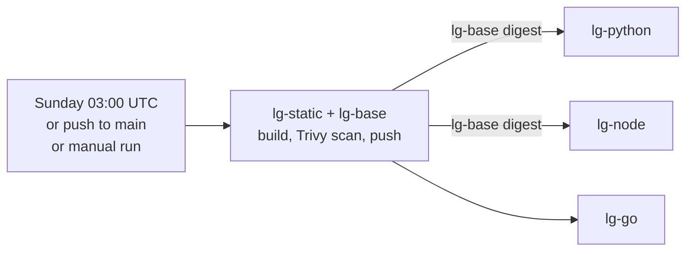
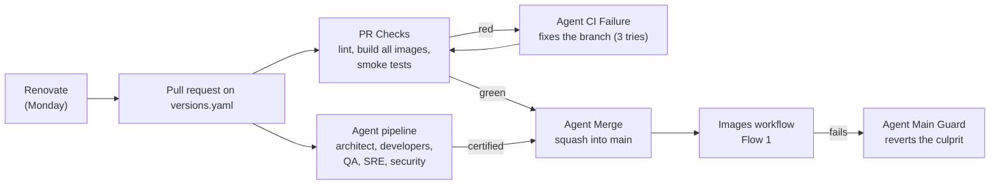

# ACT-lg-baseimg

Distroless base images for the k8s.it applications. No shell, no package manager, non-root (uid 65532).
They **rebuild and update themselves**: the OS layer moves every week with no change in this repository, and the
runtime versions (Python, Node, Go) move only by a reviewed pull request.

## Goals

1. **Small attack surface**: nothing in a runtime image except what the application needs. No shell, no `curl`, no apt.
2. **Always patched**: new glibc / OpenSSL / tzdata / CA bundle reach the images without anyone touching the repo.
3. **Reproducible and reviewable**: every version is pinned in one file, `versions.yaml`; a pinned version changes
   by pull request only.
4. **Nobody babysits it**: Renovate proposes, the agent pipeline reviews, CI proves, the merge is automatic when all
   is green, and a broken `main` reverts itself.

## Images

| Image | What it is | Size (arm64) | Use it for |
|---|---|---|---|
| `lgirardi/lg-static` | CA certificates, tzdata, nonroot user. No libc | 1.5 MB | Go (`CGO_ENABLED=0`), Rust musl, any static binary |
| `lgirardi/lg-base` | `lg-static` + glibc, libstdc++, OpenSSL | 17 MB | C/C++, anything dynamically linked; the layer the runtimes sit on |
| `lgirardi/lg-python` | CPython `<pinned>` on `lg-base` | 54 MB | Python services |
| `lgirardi/lg-node` | Node.js `<pinned LTS>` on `lg-base` | 141 MB | Node services |
| `lgirardi/lg-go` | Go `<pinned>` toolchain, **build stage only** | 479 MB | `FROM lg-go AS build`; the runtime is `lg-static` |

Also on `ghcr.io/lorenzogirardi/<name>`.

**Tags**

| Tag | Moves | Example |
|---|---|---|
| `edge` | every build (base layers) | `lg-static:edge` |
| minor | with patch releases | `3.15`, `24`, `1.27` |
| exact | never, until the runtime is bumped | `3.15.2` |
| exact + date | immutable in practice | `3.15.2-20261121` |

**In production pin the dated tag or the digest**: adopting a new base is then your decision and a rollback is a tag change.

## Use

```dockerfile
# Python: dependencies are installed in a build stage of the SAME version, the venv is copied over
FROM python:3.15.2-slim-trixie AS build
RUN python -m venv /venv
COPY requirements.txt .
RUN /venv/bin/pip install --no-cache-dir -r requirements.txt

FROM lgirardi/lg-python:3.15.2
COPY --from=build /venv /venv
COPY --chown=65532:65532 app/ /app/app/
WORKDIR /app
EXPOSE 8000
ENTRYPOINT ["/venv/bin/python", "-m", "uvicorn"]
CMD ["app.main:app", "--host", "0.0.0.0", "--port", "8000"]
```

```dockerfile
# Go
FROM lgirardi/lg-go:1.27 AS build
COPY . .
RUN go build -o /out/app ./cmd/app
FROM lgirardi/lg-static:edge
COPY --from=build /out/app /app
ENTRYPOINT ["/app"]
```

## Things a distroless image cannot do

- **No `HEALTHCHECK` with `curl`**: use Kubernetes probes, or a Python/Node one-liner as the check command.
- **No `ping`, `traceroute`, `dig`**: they are binaries, and need capabilities. A service that shells out to them
  (pytbak's network tools do) must implement them in the language, or run on a different image.
- **No shell to exec into**: `kubectl debug -it <pod> --image=busybox --target=<container>`.

## How it works

Two independent flows keep the images current. Details in [docs/pipeline.md](docs/pipeline.md).

### Flow 1: the OS layer (no change in git)



Runtimes build `FROM lg-base@sha256:<digest just published>`, never `:edge`. Each image is scanned with Trivy
before it is pushed: a CRITICAL vulnerability **with a fix available** blocks the publish, and a base that did not
publish leaves the runtimes unbuilt.

### Flow 2: a pinned version changes (pull request)



| Update | Renovate does | A person does |
|---|---|---|
| Patch of Python / Node / Go | One grouped pull request every Monday | Nothing: agents review and merge |
| Minor or major of a runtime | Waits on the **Dependency Dashboard** issue | Ticks the box to approve |
| Node odd major | Never proposed (LTS only) | - |
| Debian snapshot | Pull request for the next dated tag | Nothing |
| GitHub Actions | One grouped pull request, pinned by digest | Nothing |

Renovate merges nothing itself: the merge authority is `Agent Merge`, after certification and green checks.

## Rules in short

- A version lives in `versions.yaml` and nowhere else; Dockerfiles take it as an `ARG`.
- Versions are exact (`3.15.2`): no ranges, no `latest`, no floating tag.
- No shell, package manager or `curl` in a runtime image.
- No agent edits `.github/workflows/`: a change to the pipeline is written by a person.
- Secrets are repository secrets, never committed.

Full list for agents and people: [CLAUDE.md](CLAUDE.md).

## Repository map

| Path | What |
|---|---|
| `versions.yaml` | The only place a pinned version is written |
| `images/` | Dockerfiles (`base`, `python`, `node`, `go`) and `mkrootfs.sh` (rootfs from Debian packages) |
| `scripts/` | `versions.py`, `build.sh`, `test-images.sh`, `verify.sh` |
| `tests/` | Unit tests, including the `versions.yaml` rules |
| `.github/workflows/` | `pipeline.yml` (cascade), `pr-checks.yml`, the `agent-*` workflows |
| `legacy/` | Old `lg-baseimg` / `lg-flaskimg`, rebuilt weekly until nothing pulls them |
| `docs/pipeline.md` | Cascade, update mechanism, agent pipeline, required repository config |

## Local

```bash
scripts/verify.sh                           # fast: versions.yaml + unit tests
scripts/build.sh && scripts/test-images.sh  # slow, needs Docker: builds lg-*:local and smoke-tests them
```
