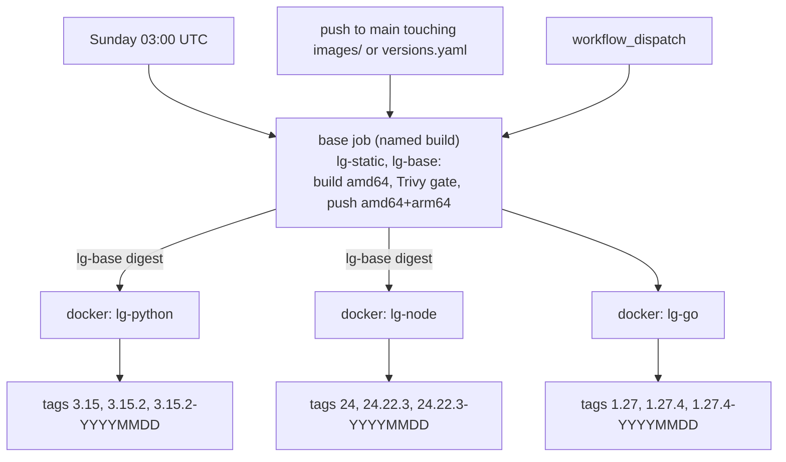
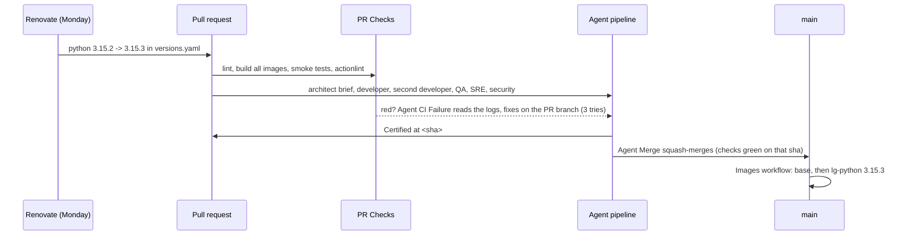

# Pipeline: cascade, pinned versions and self-maintenance

## 1. What is pinned, and where

`versions.yaml` is the only file that names a version. The Dockerfiles take `DEBIAN_TAG`, `PYTHON_VERSION`,
`NODE_VERSION` and `GO_VERSION` as build args; the workflows and `scripts/build.sh` read them through
`scripts/versions.py`. `tests/test_versions.py` fails if a runtime is not an exact `major.minor.patch`, if the Debian
tag is not a dated snapshot, or if a line has no `# renovate:` hint (Renovate could not move it).

**Pinned** (changes only by a pull request): Debian snapshot, Python, Node, Go.
**Floating on purpose** (changes on every build): the Debian *packages* (glibc, OpenSSL, tzdata, CA bundle) installed
on top of the pinned snapshot. That is what a weekly rebuild is for.

## 2. The cascade

- Runtimes start `FROM lg-base@sha256:<digest of the base just published>`, never `:edge`: each runtime is tied to a
  precise base and the build is reproducible. A base that did not publish (scan failed) leaves the runtimes unbuilt.
- Each image is built for amd64 and scanned with Trivy first; a CRITICAL vulnerability **with a fix available**
  blocks the publish. Then it is built for amd64+arm64 and pushed with SBOM and provenance.
- The scheduled run is the update mechanism for the OS layer: new glibc/OpenSSL -> new `lg-base` -> new runtimes, with
  no change in this repository.

## 3. How a pinned version changes

| Update | Renovate does | A person does |
|---|---|---|
| Patch of Python / Node / Go | Opens one grouped pull request every Monday | Nothing: the agents review and merge it |
| Minor or major of a runtime | Waits: it appears on the **Dependency Dashboard** issue | Ticks the box to approve; then it is a normal pull request |
| Node odd major | Never proposed (LTS only) | - |
| Debian snapshot | Pull request for the next dated tag | Nothing |
| GitHub Actions | One grouped pull request, pinned by digest | Nothing (a workflow-file change is reviewed like any other) |

Renovate merges nothing itself: the merge authority is `Agent Merge`, after certification and green checks.

## 4. The AI workflow

The same agent pipeline as `flask-test-api`, from `lorenzogirardi/ci-shared@v3`. The roles and the code that acts on
their output live there; this repository wires them up (see the `flask-test-api` document `docs/13-agent-pipeline.md`
for the full behaviour).

| Workflow | When | What |
|---|---|---|
| `agent-change.yml` | Every pull request (Renovate's included); a push to `main` with no PR | Architect brief, developer, second developer, QA, SRE, security, docs; one comment on the PR |
| `agent-ci-failure.yml` | `PR Checks` fails | Reads the real logs, decides code vs test, pushes a fix to the PR branch (3 tries) |
| `agent-merge.yml` | `PR Checks` succeeds, push to `main`, every 30 min | Squash-merges a certified pull request whose checks (`lint`, `build`, `workflows`) are green |
| `agent-main-guard.yml` | `Images` fails after a merge | Reverts the culprit; circuit breaker after 3 reverts in 24 h |
| `pipeline-health.yml` | Events + every 30 min | No model: finds unbuilt commits, stuck PRs, failing agent workflows |
| `pipeline-canary.yml` | Nightly | A known change to `scripts/canary.py` through the whole pipeline, outcome checked |
| `changelog.yml`, `release-notes.yml`, `docs-architect.yml` | After merge / by hand | `CHANGELOG.md`, release notes comment, documentation proposal |

### What must be configured on the GitHub repository (not in git)

| Kind | Name | Purpose |
|---|---|---|
| Variable | `AI_ENABLED=true` | Switches the agent workflows on |
| Variables | `OPENROUTER_MODEL`, `OPENROUTER_ENDPOINT`, `OPENROUTER_SITE_URL`, `OPENROUTER_APP_NAME` | Model for the agents |
| Secret | `OPENROUTER_API_KEY` | Model key (put a spending cap on the key itself) |
| Secret | `AUTOFIX_PUSH_TOKEN` | Fine-grained PAT, this repo only: Contents + Pull requests + Workflows read/write. Pushes fixes and merges so the workflows on `main` start |
| Secrets | `DOCKERHUB_USERNAME`, `DOCKERHUB_TOKEN` | Publish to Docker Hub |
| App | Renovate (GitHub App) | Dependency pull requests |
| Packages | Make `lg-*` on ghcr.io public | New packages start private; consumers outside the repo cannot pull them otherwise |

## 5. Known limits

- A new Debian package fix that lands after the Sunday build reaches the images the following Sunday, or at the next
  push to `main`; run `Images` by hand (`workflow_dispatch`) for an urgent one.
- `lg-python` copies the official CPython build; the libraries it links are discovered with `ldd` at build time
  (`images/python/deps.sh`), so a new Python that needs a new library is handled by itself, and `scripts/test-images.sh`
  imports every extension module to prove it.
- Agent Main Guard reverts only for jobs named `build` or `docker` (list kept in `ci-shared`), hence the job names in
  `pipeline.yml`.
